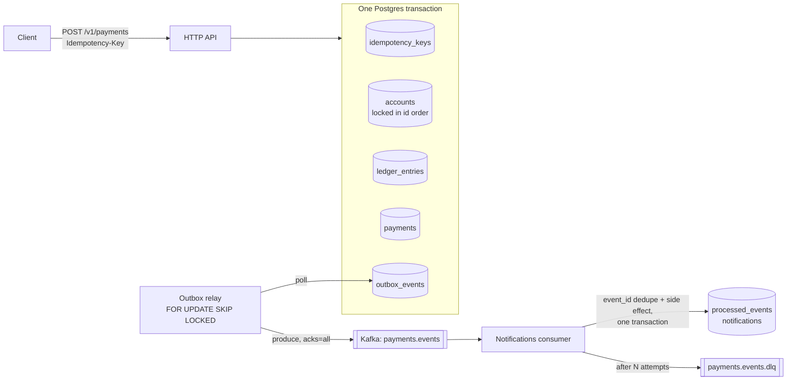
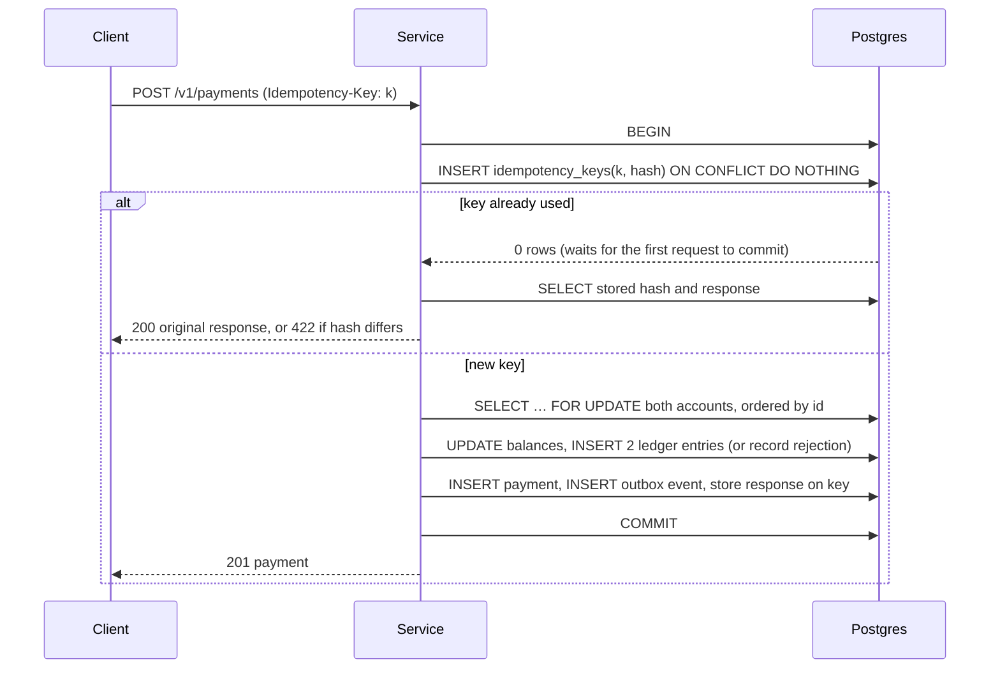

# Payment Simulator

[](https://github.com/xeeshan16/payment-simulator/actions/workflows/ci.yml)

A small payment service built to get the hard parts of money movement right: **idempotent requests, concurrent transfers without deadlocks or lost updates, a double-entry ledger, and reliable event publishing through a transactional outbox to an idempotent Kafka consumer with a dead-letter topic.**

All data is synthetic. Nothing here comes from, or connects to, a real payment system.

## What it demonstrates

| Problem | How it's handled | Proven by |
| --- | --- | --- |
| A client retries after a timeout | `Idempotency-Key` is claimed in the same transaction as the transfer; a retry gets the original response (`200`, `Idempotent-Replayed: true`) | `TestRetryWithSameKeyReplaysOriginalResponse` |
| 40 identical requests arrive at once | The key's primary key makes concurrent claims queue behind the first; exactly one payment is created | `TestConcurrentRequestsWithSameKeyCreateOnePayment` |
| Same key, different request | Request is hashed and compared; mismatch returns `422 idempotency_key_reused` | `TestReusingKeyForDifferentRequestFails` |
| Opposite transfers between the same accounts | Rows are locked in a fixed order (by id), so lock cycles can't form | `TestConcurrentTransfersPreserveInvariants` |
| Overdraft / lost update under contention | `SELECT … FOR UPDATE` plus a `CHECK` constraint; insufficient funds is a recorded *rejection*, not an error | same test, plus ledger invariants |
| Money created or destroyed by a bug | Every movement is a balanced double-entry journal; opening balances are funded from a per-currency system account so the whole ledger sums to zero | `checkInvariants` runs after every test |
| Event lost if the app crashes after commit | Transactional outbox: the event row commits with the payment; a relay publishes it afterwards | `TestFailedPublishIsRetried` |
| Several relay instances | Rows are claimed with `FOR UPDATE SKIP LOCKED`; each event is published once | `TestConcurrentRelaysPublishEachEventOnce` |
| Kafka redelivers a message | Consumer records `event_id` in the same transaction as its side effect; duplicates are no-ops | `TestDuplicateDeliveryIsAppliedOnce` |
| Poison or permanently failing message | Bounded retries with backoff, then the record goes to `payments.events.dlq` with diagnostic headers, and the partition keeps moving | `TestRetriesAndDeadLetters` |

Two of these tests were checked against deliberately broken code: removing the lock ordering makes the concurrency test fail with Postgres deadlocks (`40P01`), and removing the row locks makes it fail on the ledger invariants.

## Architecture



### Request flow



Design decisions and their trade-offs are written up in [`docs/adr`](docs/adr).

## API

| Method | Path | Notes |
| --- | --- | --- |
| `POST` | `/v1/accounts` | `{"owner","currency","opening_balance"}`; amounts are integer minor units |
| `GET` | `/v1/accounts/{id}` | |
| `POST` | `/v1/payments` | Requires `Idempotency-Key`. `{"from_account","to_account","amount","currency","reference"}` |
| `GET` | `/v1/payments/{id}` | |
| `GET` | `/healthz` | |

```bash
curl -s -XPOST localhost:8080/v1/payments \
  -H 'Idempotency-Key: order-1001' \
  -d '{"from_account":"<alice>","to_account":"<bob>","amount":2500,"currency":"AED","reference":"invoice 1001"}'
```

Errors use one shape: `{"code":"idempotency_key_reused","message":"…"}` with `400` (invalid request), `404`, or `422` (currency mismatch, key reuse).

## Running it

**Everything in Docker:**

```bash
docker compose up --build      # Postgres 18, Kafka (KRaft), simulator on :8080
```

**Tests** need a Postgres the tests can create databases in. Kafka is provided in-process by [kfake](https://pkg.go.dev/github.com/twmb/franz-go/pkg/kfake), so no broker is needed:

```bash
docker compose up -d postgres
make test                       # go test -race ./...
```

Without `PAYSIM_TEST_DATABASE_URL`, integration tests are skipped rather than failing. CI always runs them against a real Postgres service container.

| Variable | Default |
| --- | --- |
| `PAYSIM_DATABASE_URL` | required |
| `PAYSIM_KAFKA_BROKERS` | `localhost:9092` |
| `PAYSIM_HTTP_ADDR` | `:8080` |
| `PAYSIM_TOPIC` / `PAYSIM_DLQ_TOPIC` | `payments.events` / `payments.events.dlq` |
| `PAYSIM_CONSUMER_GROUP` | `paysim-notifications` |

## Project layout

```
cmd/paysim            wiring: config, HTTP server, relay, consumer, graceful shutdown
internal/payment      accounts, transfers, ledger, idempotency, outbox writes
internal/outbox       relay: claim → publish → mark published
internal/consumer     at-least-once consumer with dedupe, retries, DLQ
internal/kafka        franz-go publisher
internal/httpapi      JSON/HTTP handlers and error mapping
internal/db           pool + embedded SQL migrations
```

## Status and roadmap

This is the first slice: synchronous transfers, the outbox pipeline and one sample consumer. Next up are load testing with published p50/p95/p99 numbers, OpenTelemetry tracing across the outbox hop, refunds and reversals, and reconciliation. See [ROADMAP.md](ROADMAP.md).

Built with Go 1.26, PostgreSQL, [pgx](https://github.com/jackc/pgx) and [franz-go](https://github.com/twmb/franz-go).
