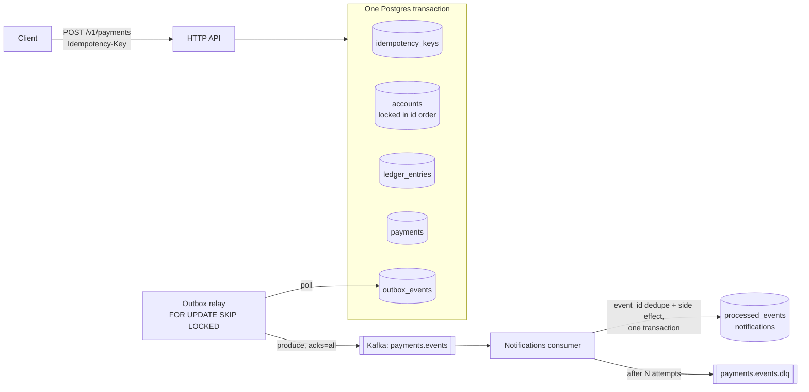
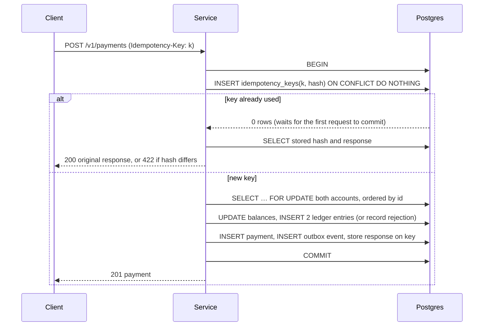

# Payment Simulator

[](https://github.com/xeeshan16/payment-simulator/actions/workflows/ci.yml)

A small payment service built to get the hard parts of money movement right: **idempotent requests, concurrent transfers without deadlocks or lost updates, a double-entry ledger, and reliable event publishing through a transactional outbox to an idempotent Kafka consumer with a dead-letter topic.**

All data is synthetic. Nothing here comes from, or connects to, a real payment system.

## What it demonstrates

| Problem | How it's handled | Proven by |
| --- | --- | --- |
| A client retries after a timeout | `Idempotency-Key` is claimed in the same transaction as the transfer; a retry gets the original response (`200`, `Idempotent-Replayed: true`) | `TestRetryWithSameKeyReplaysOriginalResponse` |
| 40 identical requests arrive at once | The key's primary key makes concurrent claims queue behind the first; exactly one payment is created | `TestConcurrentRequestsWithSameKeyCreateOnePayment` |
| Same key, different request | Request is hashed and compared; mismatch returns `422 idempotency_key_reused` | `TestReusingKeyForDifferentRequestFails` |
| Opposite transfers between the same accounts | Rows are locked in a fixed order (by id), so lock cycles can't form | `TestConcurrentTransfersPreserveInvariants` |
| Overdraft / lost update under contention | `SELECT … FOR UPDATE` plus a `CHECK` constraint; insufficient funds is a recorded *rejection*, not an error | same test, plus ledger invariants |
| Money created or destroyed by a bug | Every movement is a balanced double-entry journal; opening balances are funded from a per-currency system account so the whole ledger sums to zero | `checkInvariants` runs after every test |
| Event lost if the app crashes after commit | Transactional outbox: the event row commits with the payment; a relay publishes it afterwards | `TestFailedPublishIsRetried` |
| Several relay instances | Rows are claimed with `FOR UPDATE SKIP LOCKED`; each event is published once | `TestConcurrentRelaysPublishEachEventOnce` |
| Kafka redelivers a message | Consumer records `event_id` in the same transaction as its side effect; duplicates are no-ops | `TestDuplicateDeliveryIsAppliedOnce` |
| Poison or permanently failing message | Bounded retries with backoff, then the record goes to `payments.events.dlq` with diagnostic headers, and the partition keeps moving | `TestRetriesAndDeadLetters` |

Two of these tests were checked against deliberately broken code: removing the lock ordering makes the concurrency test fail with Postgres deadlocks (`40P01`), and removing the row locks makes it fail on the ledger invariants.

## Architecture



### Request flow



Design decisions and their trade-offs are written up in [`docs/adr`](docs/adr).

## API

| Method | Path | Notes |
| --- | --- | --- |
| `POST` | `/v1/accounts` | `{"owner","currency","opening_balance"}`; amounts are integer minor units |
| `GET` | `/v1/accounts/{id}` | |
| `POST` | `/v1/payments` | Requires `Idempotency-Key`. `{"from_account","to_account","amount","currency","reference"}` |
| `GET` | `/v1/payments/{id}` | |
| `GET` | `/healthz` | |

```bash
curl -s -XPOST localhost:8080/v1/payments \
  -H 'Idempotency-Key: order-1001' \
  -d '{"from_account":"<alice>","to_account":"<bob>","amount":2500,"currency":"AED","reference":"invoice 1001"}'
```

Errors use one shape: `{"code":"idempotency_key_reused","message":"…"}` with `400` (invalid request), `404`, or `422` (currency mismatch, key reuse).

## Running it

**Everything in Docker:**

```bash
docker compose up --build      # Postgres 18, Kafka (KRaft), simulator on :8080
```

**Tests** need a Postgres the tests can create databases in. Kafka is provided in-process by [kfake](https://pkg.go.dev/github.com/twmb/franz-go/pkg/kfake), so no broker is needed:

```bash
docker compose up -d postgres
make test                       # go test -race ./...
```

Without `PAYSIM_TEST_DATABASE_URL`, integration tests are skipped rather than failing. CI always runs them against a real Postgres service container.

| Variable | Default |
| --- | --- |
| `PAYSIM_DATABASE_URL` | required |
| `PAYSIM_KAFKA_BROKERS` | `localhost:9092` |
| `PAYSIM_HTTP_ADDR` | `:8080` |
| `PAYSIM_TOPIC` / `PAYSIM_DLQ_TOPIC` | `payments.events` / `payments.events.dlq` |
| `PAYSIM_CONSUMER_GROUP` | `paysim-notifications` |
| `PAYSIM_OUTBOX_RETENTION` | `168h`: published outbox rows older than this are pruned in batches; `0` keeps them forever |

## Load testing

`cmd/loadgen` opens a fresh set of synthetic accounts on a running simulator, then sends concurrent `POST /v1/payments` requests (each with a unique `Idempotency-Key`) and reports throughput, p50/p95/p99/max latency and outcomes (`completed`, `rejected`, `http_<status>`, `transport_error`):

```bash
docker compose up --build -d
go run ./cmd/loadgen -accounts 100 -workers 32 -duration 30s
# contention on popular accounts: 80% of transfers touch one of 2 hot accounts
go run ./cmd/loadgen -accounts 100 -workers 32 -duration 30s -hot-accounts 2 -hot-ratio 0.8
```

Run `go run ./cmd/loadgen -h` for every flag (`-requests`, `-max-amount`, `-opening-balance`, `-seed`, …). Latency is measured client-side per request.

### Results

Measured by the [Benchmark workflow](.github/workflows/bench.yml) ([run 44987677746](https://github.com/xeeshan16/payment-simulator/actions/runs/44987677746)), which starts the `docker compose` stack on a GitHub-hosted runner and runs both scenarios for 30 s each with 32 workers and 100 fresh accounts:

| Scenario | Requests | Throughput | p50 | p95 | p99 | max | Outcomes |
| --- | --: | --: | --: | --: | --: | --: | --- |
| Uniform (`-seed 1`) | 45,154 | 1,505.0 req/s | 18.54 ms | 30.32 ms | 53.68 ms | 140.02 ms | all `completed` |
| Hot: 80% touch 1 of 2 accounts (`-seed 2`) | 36,352 | 1,211.5 req/s | 23.80 ms | 36.58 ms | 54.90 ms | 526.74 ms | all `completed` |

Hardware: 4 vCPUs (Intel Xeon Platinum 8573C), 15 GiB RAM, Linux 7.0 (Azure), Docker Compose v5.1.3. Postgres, Kafka, the simulator and loadgen all share that one machine, with default Postgres settings. Treat these as a baseline for comparing changes, not as a capacity figure: GitHub-hosted runners vary in CPU model between runs, so compare numbers from the same run or several runs. Contention on two hot accounts cost about 20% of throughput and raised the tail (max 527 ms) in this run, as expected when transfers touching the same account queue on its row lock.

To reproduce, trigger the workflow from the Actions tab (duration and workers are inputs). Use a different `-seed` for each run against the same database: Idempotency-Keys are derived from the seed, so repeating one turns the second run into key-reuse `422`s.

## Project layout

```
cmd/paysim            wiring: config, HTTP server, relay, pruner, consumer, graceful shutdown
cmd/loadgen           HTTP load generator: concurrent transfers, hot-account skew, latency percentiles
internal/payment      accounts, transfers, ledger, idempotency, outbox writes
internal/outbox       relay: claim → publish → mark published; pruner for published rows
internal/consumer     at-least-once consumer with dedupe, retries, DLQ
internal/kafka        franz-go publisher
internal/httpapi      JSON/HTTP handlers and error mapping
internal/db           pool + embedded SQL migrations
```

## Status and roadmap

This is the first slice: synchronous transfers, the outbox pipeline and one sample consumer. Load-test results are published above; next up are Prometheus metrics, OpenTelemetry tracing across the outbox hop, refunds and reversals, and reconciliation. See [ROADMAP.md](ROADMAP.md).

Built with Go 1.26, PostgreSQL, [pgx](https://github.com/jackc/pgx) and [franz-go](https://github.com/twmb/franz-go).
